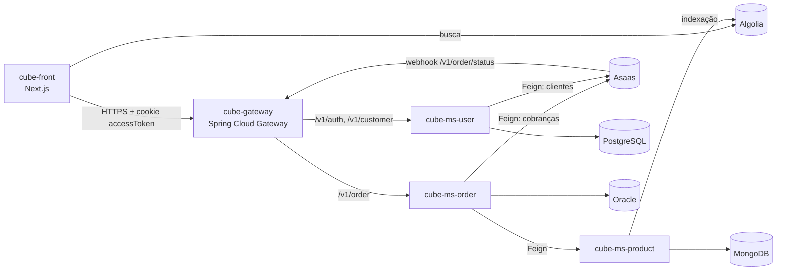

# cube-front

Front-end do **Cube**, um e-commerce construído em microsserviços. É uma loja em **Next.js** com catálogo e busca instantânea via Algolia, carrinho, cadastro e login, checkout em etapas e acompanhamento de pedidos. Roda na **Cloudflare** (Workers) em `cube.matheus-junior.xyz`.

## Ecossistema Cube



Todos os serviços e o gateway se registram no **cube-ms-eureka**.

| Repositório | Papel | Stack |
| --- | --- | --- |
| **cube-front** (este repositório) | Loja (interface web) | Next.js, Chakra UI, Algolia |
| [cube-gateway](https://github.com/MatheysJ/cube-gateway) | API Gateway e autenticação JWT | Spring Cloud Gateway |
| [cube-ms-eureka](https://github.com/MatheysJ/cube-ms-eureka) | Descoberta de serviços | Netflix Eureka Server |
| [cube-ms-user](https://github.com/MatheysJ/cube-ms-user) | Usuários e login | Spring Boot, PostgreSQL |
| [cube-ms-product](https://github.com/MatheysJ/cube-ms-product) | Catálogo de produtos | Spring Boot, MongoDB, Algolia |
| [cube-ms-order](https://github.com/MatheysJ/cube-ms-order) | Pedidos e pagamentos | Spring Boot, Oracle, Asaas |
| [cube-admin](https://github.com/MatheysJ/cube-admin) | Painel administrativo (em planejamento) | - |

## Funcionalidades

- **Catálogo e busca** com Algolia InstantSearch (caixa de busca, resultados e paginação), 40 produtos por página.
- **Carrinho** persistente com `react-use-cart`.
- **Cadastro** em 3 etapas (informações de login, pessoais e de contato) e **login** com cookie de sessão.
- **Checkout** em 3 etapas: revisão dos produtos, entrega ou retirada e pagamento. Exige usuário logado e, hoje, oferece pagamento por **PIX** (boleto e cartão aparecem desabilitados).
- **Pedidos**: listagem dos pedidos do usuário e página de detalhes de cada pedido.
- Interface com Chakra UI v3 e suporte a tema claro e escuro.

## Páginas

| Rota | Descrição |
| --- | --- |
| `/` | Catálogo com busca |
| `/login` | Login |
| `/register` | Cadastro em etapas |
| `/checkout` | Finalização da compra (requer login) |
| `/orders` | Meus pedidos |
| `/order/[slug]` | Detalhes de um pedido |

## Tecnologias

- Next.js 15 (Pages Router) com Turbopack no desenvolvimento
- React 19 e TypeScript
- Chakra UI v3, Emotion e styled-components
- TanStack Query v5 (dados e cache), React Hook Form (formulários)
- Algolia (`algoliasearch` e `react-instantsearch`)
- `cookies-next` e `react-use-cart`
- Deploy com `@opennextjs/cloudflare` e Wrangler (Cloudflare Workers)
- Gerenciador de pacotes: Yarn

## Como o front conversa com o backend

Toda chamada à API vai para o [cube-gateway](https://github.com/MatheysJ/cube-gateway) com `credentials: "include"`: o gateway lê o cookie `accessToken` emitido no login. O catálogo não passa pelo gateway, e sim direto pelo Algolia.

O cookie é emitido pelo `cube-ms-user` com `domain=matheus-junior.xyz` e `Secure`. Por isso login e checkout só funcionam em um host sob esse domínio e com HTTPS, e não em `localhost`.

## Variáveis de ambiente

Crie um arquivo `.env.local` na raiz (arquivos `.env*` estão no `.gitignore`):

| Variável | Descrição |
| --- | --- |
| `NEXT_PUBLIC_ALGOLIA_APP_ID` | Application ID do Algolia |
| `NEXT_PUBLIC_ALGOLIA_API_KEY` | Chave de **busca** do Algolia (pública; nunca use a chave de administração) |
| `NEXT_PUBLIC_ALGOLIA_CATALOG_INDEX` | Nome do índice do catálogo (o `cube-ms-product` grava em `products_index`) |
| `NEXT_PUBLIC_HOST` | URL base do gateway, por exemplo `https://api.exemplo.com` |
| `NEXT_PUBLIC_AUTH_SERVICE` | Caminho do serviço de autenticação: `/v1/auth` |
| `NEXT_PUBLIC_CUSTOMER_SERVICE` | Caminho do serviço de cliente: `/v1/customer` |
| `NEXT_PUBLIC_ORDER_SERVICE` | Caminho do serviço de pedidos: `/v1/order` |

Exemplo:

```env
NEXT_PUBLIC_ALGOLIA_APP_ID=XXXXXXXXXX
NEXT_PUBLIC_ALGOLIA_API_KEY=<chave de busca>
NEXT_PUBLIC_ALGOLIA_CATALOG_INDEX=products_index
NEXT_PUBLIC_HOST=https://api.exemplo.com
NEXT_PUBLIC_AUTH_SERVICE=/v1/auth
NEXT_PUBLIC_CUSTOMER_SERVICE=/v1/customer
NEXT_PUBLIC_ORDER_SERVICE=/v1/order
```

## Como executar

Pré-requisitos: Node.js 20+ e Yarn.

```bash
yarn install
yarn dev
```

A aplicação abre em <http://localhost:3000>.

### Scripts

| Comando | Descrição |
| --- | --- |
| `yarn dev` | Servidor de desenvolvimento (Turbopack) |
| `yarn build` | Build de produção do Next.js |
| `yarn start` | Servidor de produção local |
| `yarn lint` | ESLint |
| `yarn preview` | Build com OpenNext e preview local no runtime do Cloudflare |
| `yarn deploy` | Build com OpenNext e deploy no Cloudflare Workers |
| `yarn upload` | Build com OpenNext e upload de uma nova versão do Worker |
| `yarn cf-typegen` | Gera os tipos do ambiente Cloudflare (`cloudflare-env.d.ts`) |

### Deploy na Cloudflare

O `wrangler.jsonc` define o Worker `cube-front-github` com a rota `cube.matheus-junior.xyz/*`. Com o Wrangler autenticado (`npx wrangler login`):

```bash
yarn deploy
```

## Estrutura

```
src/
├── pages/         # Rotas (Pages Router): /, login, register, checkout, orders, order/[slug]
├── components/    # Catalog, Checkout, Header (carrinho, login, usuário), Login, Register, Orders...
│   ├── Custom/Algolia/   # Hits, SearchBox e Pagination do InstantSearch
│   └── Common/           # Componentes reutilizáveis (inputs, cards, cubo 3D animado)
├── services/      # Chamadas HTTP: auth, customer e order
├── providers/     # UserProvider (sessão do usuário)
├── contexts/      # UserContext
├── hooks/
├── config/theme/  # Tema do Chakra UI
├── constants/
├── types/
└── utils/         # Formatação de moeda, retry, mapeadores e toasts
```

## Autor

Desenvolvido por [@MatheysJ](https://github.com/MatheysJ).
